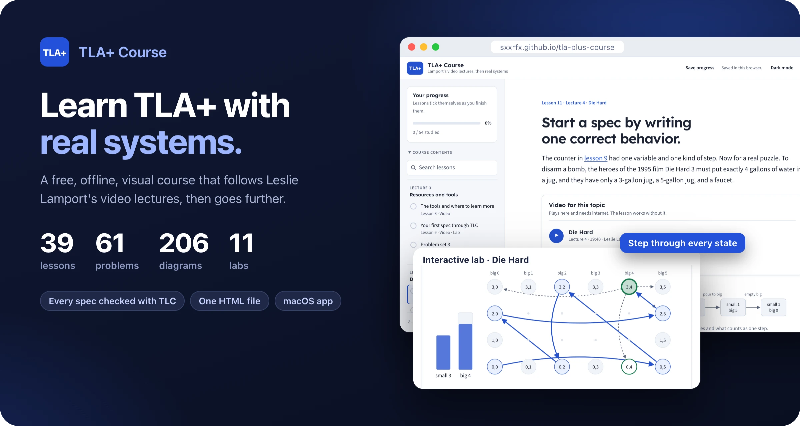
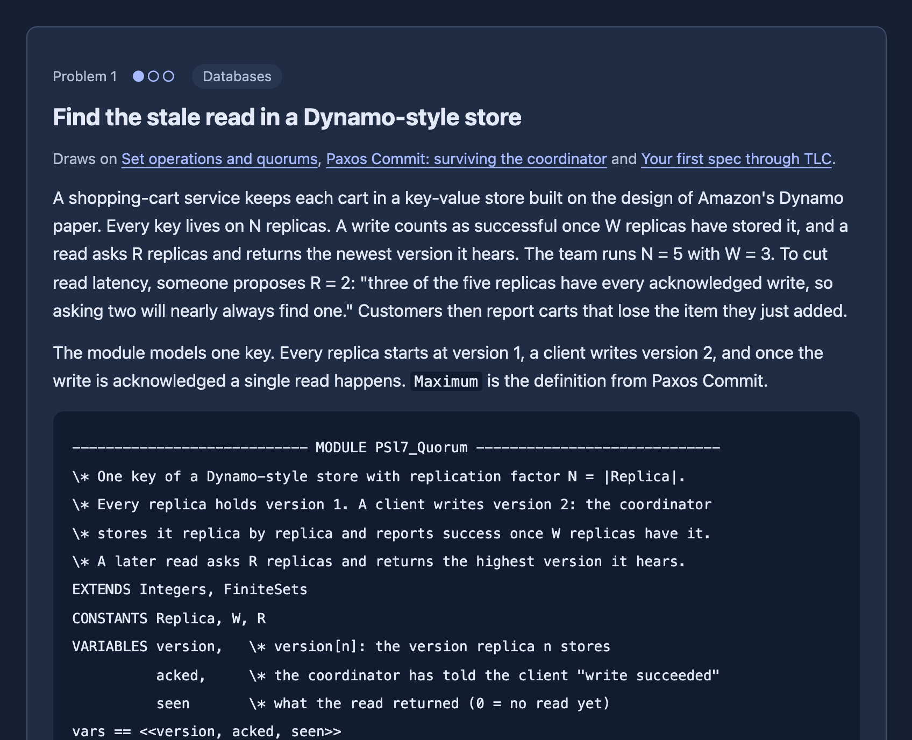
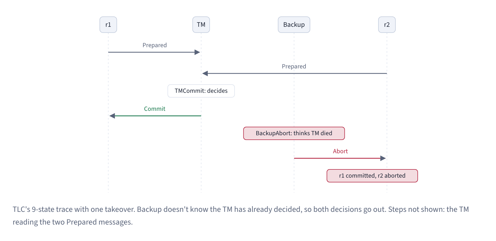
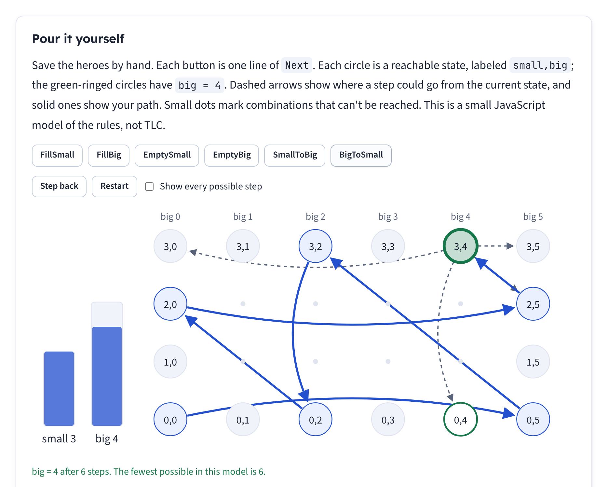
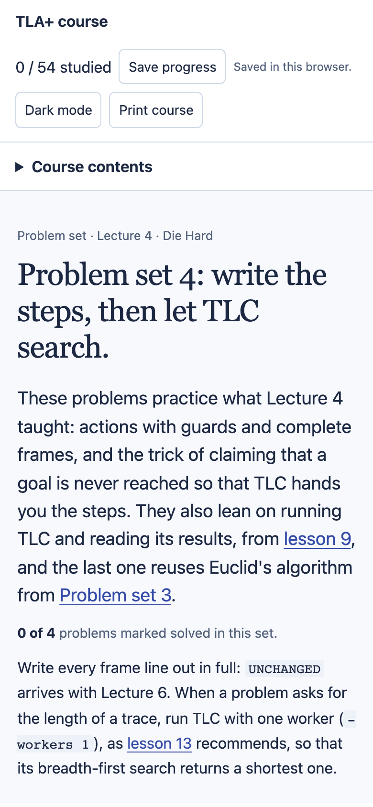

# TLA+ Course

An offline, visual course for learning [TLA+](https://lamport.azurewebsites.net/tla/tla.html), Leslie Lamport's language for specifying and model-checking concurrent and distributed systems. It follows Lamport's [TLA+ video course](https://lamport.azurewebsites.net/video/videos.html) lecture by lecture, then goes beyond it into concurrency, proofs, failure-prone systems and applied models. Each chapter ends with a problem set built from real systems.

**Take the course online at [sxxrfx.github.io/tla-plus-course](https://sxxrfx.github.io/tla-plus-course/).**

The whole course is one HTML file. Open it in a browser and it works without a network connection; only the embedded lecture videos need internet. A small macOS menu-bar app is included that serves it locally and saves your progress to disk.



## What's inside

- **39 lessons in 16 parts.** Lectures 1–10 come first, in Lamport's order and with his examples: Die Hard, transaction commit, two-phase commit, Paxos Commit and the alternating bit protocol. Four "Beyond the lectures" parts and a review follow. Each lesson assumes only what came before it.
- **15 cumulative problem sets with 61 problems.** One closes each chapter, plus a final exam. Every set tests the chapter just finished together with earlier ones, and systems come back and grow from set to set. The problems are real:
  - **Databases:** expand-and-contract migrations, Postgres prepared transactions, Dynamo-style quorums, LSM trees, lost updates, write skew under snapshot isolation, cache invalidation races and read-your-writes.
  - **Distributed systems:** Raft-style elections and log matching, leases with fencing tokens, idempotency keys, the transactional outbox, sagas and a CRDT counter.
  - **Algorithms:** Tower of Hanoi, Euclid's GCD, git bisect and a lock-free ring buffer.
  - **UI design-system components:** a modal, a combobox, a tag input and an undo toast.
- **206 diagrams.** The diagrams are inline SVG drawn from the actual mechanism: state graphs, message sequences, traces and quorum overlaps. They follow the light or dark theme.
- **11 interactive labs.** You can step through Die Hard, the alternating bit protocol, quorums, fairness, a cache race and more.
- **167 self-checking questions.** There are 90 multiple-choice quizzes and 77 short-answer checks, with hints and worked solutions.
- **Automatic progress.** A lesson ticks itself when you reach the end and answer its quizzes correctly. A problem ticks itself when all of its checks are right, and a problem set when all of its problems are solved. Anything you untick by hand stays unticked.
- **Checked specs.** Every TLA+ module the course prints is in [`course/specs`](course/specs) and was checked with TLC. Every state count and trace length in the text comes from those runs.

| Problem set (dark theme) | A diagram from the Paxos Commit lesson |
|---|---|
|  |  |

| Die Hard lab | Phone layout |
|---|---|
|  |  |

## Use it

**Online.** Open [sxxrfx.github.io/tla-plus-course](https://sxxrfx.github.io/tla-plus-course/). Your progress, answers and notes are saved in that browser's local storage, so they come back when you return in the same browser. They are not synced to other browsers or devices, and clearing the site's data for `sxxrfx.github.io` erases them.

**Offline.** Download [`tla-plus-course.html`](tla-plus-course.html) and open it. Progress is saved in that browser's local storage the same way, separately from the online copy. **Save progress** forces a save. **Print course** prints every lesson.

**As a macOS app** (macOS 14 or later, Apple silicon). You need Rust and Cargo, plus Apple's command-line developer tools:

```sh
./mac-app/build.sh            # installs ~/Applications/TLA+ Course.app
```

Launch **TLA+ Course** from Spotlight. A **TLA+** item stays in the menu bar with **Open Course**, **Uninstall…** and **Quit**. The app serves the course from a loopback-only local server and keeps progress in `~/Library/Application Support/TLA+ Course/progress.json`. **Uninstall…** lists what it will remove and moves it to the Trash. See [`mac-app/README.md`](mac-app/README.md) for details.

## Build and check the course

The page is generated from the sources in [`course/`](course). You need Python 3, and to check specs, Java 11 or later.

```sh
cd course
python3 build.py              # writes ../tla-plus-course.html, lints diagrams, links and problem sets
```

To check the specs, download `tla2tools.jar` into `course/`. The course was checked with the [v1.8.0 pre-release](https://github.com/tlaplus/tlaplus/releases/tag/v1.8.0):

```sh
curl -L -o tla2tools.jar https://github.com/tlaplus/tlaplus/releases/download/v1.8.0/tla2tools.jar
./tlc.sh PSl4_Hanoi            # runs TLC on specs/PSl4_Hanoi.tla with its .cfg
python3 ps_specs.py            # every module printed in the problem sets matches a checked spec
```

For the browser tests, use [pnpm](https://pnpm.io):

```sh
pnpm install
pnpm run install-browser      # downloads Chromium for playwright-core
pnpm test                     # every page: diagrams, links, labs, phone width, script errors; then automatic progress
node screenshots.mjs          # regenerates docs/screenshots
```

### Layout

```
tla-plus-course.html     the built course (the Mac app bundles this file)
course/
  curriculum.py          lesson and problem-set order: id, part, title, videos
  src/<id>.html          lesson bodies; <id>.figs.py draws that lesson's diagrams with dg.py
  labs/*.js              interactive labs, problem-set behaviour, automatic progress
  template.html          page shell: styles, navigation, progress, videos
  build.py               assembles the page and fails on lint errors
  specs/                 every TLA+ module and TLC config the course prints
  docs/                  authoring guides for lessons and problem sets
mac-app/                 Swift menu-bar app, Rust launcher and local server
docs/screenshots/        README images
.github/workflows/       publishes tla-plus-course.html to GitHub Pages on every push to main
```

To add or change a lesson, see [`course/docs/lesson-guide.md`](course/docs/lesson-guide.md) and [`course/docs/problem-set-guide.md`](course/docs/problem-set-guide.md).

## Limits

- The labs are small JavaScript teaching models, not TLC.
- The proof lessons and problems were only parsed with SANY and checked with TLC. TLAPS was not run.
- Some facts about real products, such as Postgres isolation levels, Redis locks, Raft's membership rules and memcache leases, are stated from general knowledge rather than tested against those systems.
- A few modules are reconstructions, not Lamport's own files. AB2P is one; the lessons say which.

## License

[MIT](LICENSE). TLA+, its tools and Lamport's videos and scripts are not covered by this license; they belong to their owners.

## Credits

TLA+ and the video course are by Leslie Lamport. This is an independent study course, not affiliated with him or with the TLA+ Foundation. The videos are embedded from YouTube and linked to [Lamport's video page](https://lamport.azurewebsites.net/video/videos.html), and the lessons paraphrase rather than reproduce his scripts.
